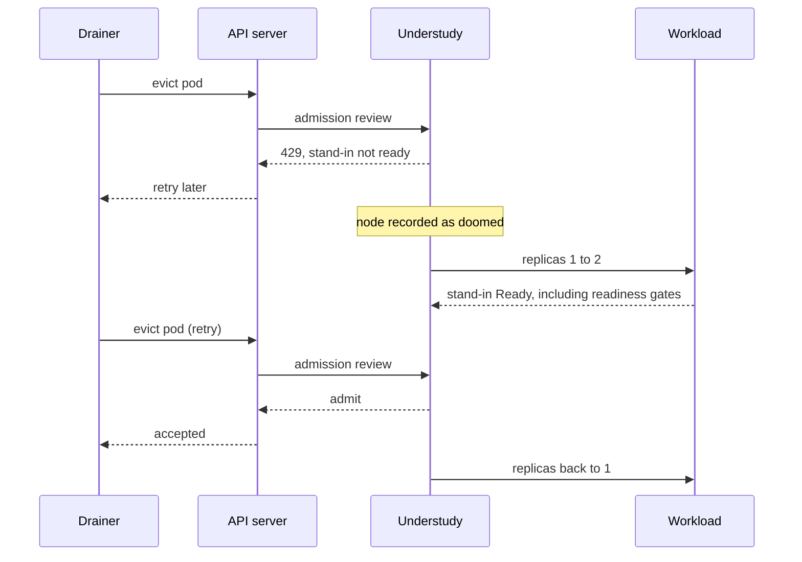
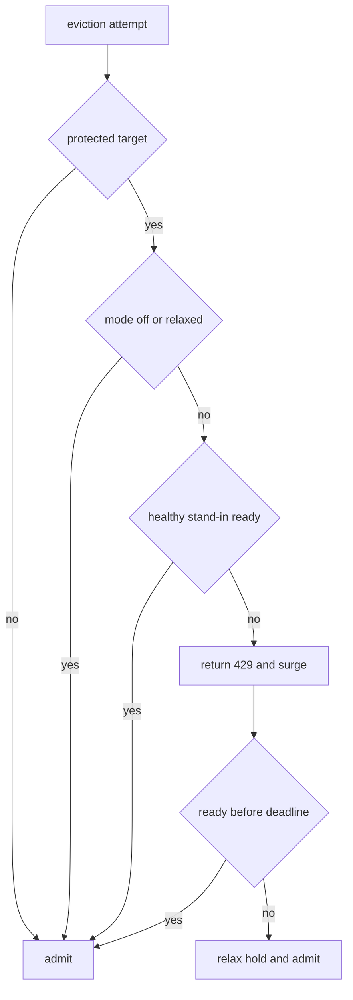

# How Understudy works

Understudy protects a single-replica Deployment or Argo Rollout during announced
node disruptions without keeping a second replica running all the time.

## The mechanism

Five steps happen in order.

**1. Answer the eviction at the door.** The always-on validating webhook
handles `pods/eviction` CREATE. For a protected pod with no ready stand-in it
returns HTTP 429 and `TooManyRequests`. Drainers already retry that response.
No PodDisruptionBudget is created, so Karpenter and cluster-autoscaler can
select a node without being blocked by a budget pre-check.

**2. Record the node as doomed.** Cordon, taint, eviction and optional cloud
sentinel adapters normalize their observations into a `NodeDoom`.

**3. Surge.** The controller increases the target workload's replica count and marks
the old pod with a negative `controller.kubernetes.io/pod-deletion-cost`.

**4. Wait for traffic readiness.** A stand-in counts only when it has been Ready
for the target's `minReadySeconds`, is not deleting, and runs on neither the
victim node nor another doomed node. Readiness gates therefore include load
balancer registration. Once enough healthy stand-ins exist, the webhook admits
the drainer's next retry.

**5. Scale back.** After the old pod leaves, the workload returns to its
original replica count, or the latest requested `baselineReplicas` when capacity
management is enabled. The deletion cost makes the old pod the preferred
scale-down target.



## Argo Rollouts

For Argo Rollouts, the same mechanism applies to fully promoted canary and
blue/green strategies. Pod selection additionally checks the
`rollouts-pod-template-hash` against `status.stableRS`, or against
`status.blueGreen.activeSelector` for blue/green. Preview pods cannot substitute
for production capacity. During progressive delivery, pauses, or aborts, the
controller and webhook stand down together. A release that starts during a surge
removes it and clears deletion-cost hints. It applies the latest desired baseline
when configured, otherwise the saved replica count.

The operator uses Argo's native replica scaling behavior and does not manage its
Services, traffic weights, analysis runs, or promotion steps. The Rollout watch
is registered only when the API is discovered at startup.

## Declarative baseline capacity

With `spec.baselineReplicas`, Understudy continuously reconciles the workload's
effective replica count. During handover, `understudy.sh/base-replicas` freezes
the baseline used for both the surge and the eviction readiness threshold.
`understudy.sh/target-revision` records the release revision so a new release
can take over an active handover. A pending baseline remains in the CR spec,
and completion applies its latest value rather than restoring an outdated one.

Baseline reconciliation also runs during release stand-down: only disruption
surging and holding stop. See [GitOps capacity](gitops-capacity.md) for the Argo
field-ownership configuration, first-install behavior, status, and retirement.

## Signals

The core consumes one provider-neutral value:

```go
NodeDoom{
    Node      string
    Class     VoluntaryUnbounded | Involuntary
    Deadline  *time.Time
    ExpiresAt *time.Time
    Source    string
}
```

| Adapter | Signal |
|---|---|
| Cordon watch | `spec.unschedulable`, including `kubectl drain` and many managed upgrades |
| Taint watch | Karpenter, cluster-autoscaler and configured drainer taints |
| Eviction webhook | Every matching eviction attempt, including eviction-only drainers |
| Cloud sentinel | Optional cloud termination notice with its deadline |

The webhook is both a signal source and the enforcement point. Dry-run
requests, deleting pods, unsupported targets and unprotected pods are admitted.
If multiple Understudy resources match a pod, every one must be ready or
relaxed before the eviction is admitted.

## Hold and release decisions

Voluntary disruption is held until the stand-in is ready. An involuntary
deadline is compared with `minSurgeTimeSeconds`; if too little time remains,
the hold is relaxed immediately while the surge continues. A hold is also
relaxed after `readinessDeadlineSeconds`, ensuring that neither an
unschedulable stand-in nor a surge the API server refuses (`SurgeReady=False`,
reason `SurgeFailed`) can wedge a drain forever.

`holdMode` chooses which of those disruptions are held in the first
place. `always` holds both classes, `voluntary-only` holds the unbounded
ones and admits anything carrying a deadline the moment it is seen, and
`off` admits everything. The mode gates the hold alone: the surge runs in
every mode, since a stand-in started early costs a pod for a few minutes
and a stand-in started late costs the outage it was meant to prevent.

The field was called `hostageMode` when a budget took the eviction
hostage. That spelling is deprecated and still honoured: a resource
setting only the old field keeps working, and the operator raises one
warning event, until the field is removed in a later release.



## Phases

| Phase | Meaning |
|---|---|
| `Idle` | No surge is active; check `Protected` for eviction protection (false during progressive delivery) |
| `Surging` | A doomed node was seen and the stand-in is not ready |
| `Releasing` | A healthy stand-in is ready and eviction retries are admitted |
| `Relaxed` | The hold was released without a ready stand-in |
| `Unsupported` | The target cannot be protected and is never held |

## Failure behaviour

The webhook uses `failurePolicy: Ignore`. If all operator replicas are
unavailable, requests fail open after `webhook.timeoutSeconds` and Kubernetes
returns to its normal eviction behavior. Deleting the
`<release>-understudy-eviction-hold` ValidatingWebhookConfiguration disables
holds immediately.

An operator restart therefore creates a protection gap rather than a stuck
cluster. Run two replicas on different nodes for production. Reconciliation
uses leader election, but every replica watches node signals and serves
webhook traffic.

The upgrade from 0.3.x runs a leader-gated startup sweep that deletes legacy
PodDisruptionBudgets labeled `understudy.sh/owned=true`. PDB read/delete RBAC
exists only for that migration and is scheduled for removal in v0.5.0.

## Metrics

- `understudy_oldest_blocked_eviction_seconds`: age of the oldest active hold
- `understudy_evictions_held_total`: admission requests answered with 429
- `understudy_eviction_attempts_observed_total`: attempts split by protection
- `understudy_surges_total`: surges by signal class
- `understudy_hold_relaxed_total`: holds relaxed by reason

## Limits

Understudy guarantees a ready replacement, not preservation of requests
already in flight. Use a `preStop` hook long enough for load balancer
deregistration.

Cold capacity still takes time. Voluntary disruptions can wait; involuntary
ones race the platform deadline. Workloads that cannot briefly run two
instances, including single-replica StatefulSets, are out of scope.
